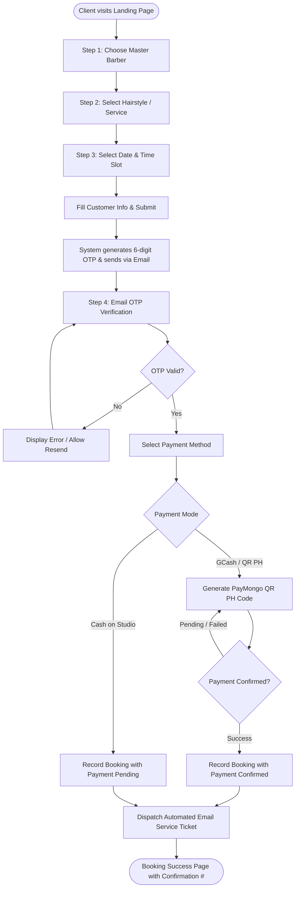
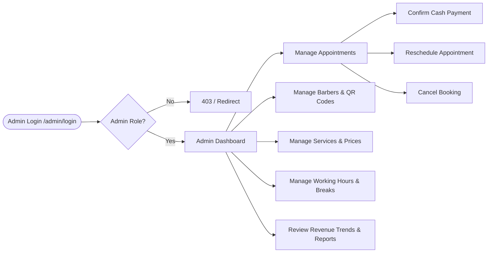

# 💈 BEZ Hair Studio — Appointment Booking & Management System

[](https://laravel.com)
[](https://react.dev)
[](https://inertiajs.com)
[](https://tailwindcss.com)
[](https://www.typescriptlang.org)
[](https://paymongo.com)

A modern full-stack web application tailored for hair salons and barbershops. Built with **Laravel 12**, **Inertia.js v2**, and **React 18 (TypeScript)**, **BEZ Hair Studio** provides a seamless client booking experience with real-time slot scheduling, email OTP verification, online GCash / QR PH payments, automated digital service tickets, and a comprehensive administrative management dashboard.

---

## 📌 Table of Contents

- [Overview & Key Features](#-overview--key-features)
- [System Architecture & Booking Flow](#-system-architecture--booking-flow)
  - [1. User Booking Flow Diagram](#1-user-booking-flow-diagram)
  - [2. Step-by-Step Customer Journey](#2-step-by-step-customer-journey)
  - [3. Administrative Operations Flow](#3-administrative-operations-flow)
- [Tech Stack](#-tech-stack)
- [Project Directory Structure](#-project-directory-structure)
- [Database Schema Overview](#-database-schema-overview)
- [Getting Started / Installation](#-getting-started--installation)
  - [Prerequisites](#prerequisites)
  - [Environment Setup](#environment-setup)
  - [Database & Seeders](#database--seeders)
  - [Running the Application](#running-the-application)
- [Admin Access & Management](#-admin-access--management)
- [Routes & API Overview](#-routes--api-overview)
- [License](#-license)

---

## 🚀 Overview & Key Features

### 💇 Client-Facing Experience
- **Interactive Landing Page**: Modern, responsive landing page showcasing studio services, master barbers, client reviews, achievements, and contact information.
- **Dynamic Slot Availability**: Prevents double-booking by querying occupied slots and disabled time windows in real time.
- **Guided Multi-Step Wizard**: A frictionless 4-step booking process with instant step validation and session persistence.
- **Two-Factor Email OTP Verification**: Verifies customer email addresses using 6-digit one-time codes cached via Redis/database/file cache before payment is allowed.
- **Flexible Payment Methods**:
  - **GCash / QR PH** powered by **PayMongo API** with real-time status polling and confirmation.
  - **Cash on Arrival** for clients who prefer in-studio payment.
- **Automated Service Tickets**: Immediate booking confirmation with a unique reference number and an automated email ticket containing appointment specifics and QR details.

### 🛡️ Administrative Portal (`/admin/dashboard`)
- **Executive Analytics**: Revenue trends, monthly gross, pending vs. confirmed appointments, and top-performing barbers with interactive Chart.js visualizations.
- **Appointment Lifecycle Management**: Real-time monitoring of all bookings with capabilities to confirm payments, reschedule times, or cancel.
- **Barber Profiles & Rostering**: Manage barber details, upload custom GCash QR codes, set default prices, and toggle working availability.
- **Hairstyle & Service Catalog**: Organize haircut packages and grooming services by category and price tier.
- **Time Slot & Schedule Governance**: Configure store operating hours, lunch breaks, and black-out dates.
- **User & Staff RBAC**: Role-based access control protecting administrative endpoints via custom middleware.

---

## 🔄 System Architecture & Booking Flow

### 1. User Booking Flow Diagram



### 2. Step-by-Step Customer Journey

1. **Step 1: Barber Selection (`/booking/step-1`)**
   - The customer browses active barbers, reviewing experience, customer ratings, portfolio styles, and base pricing.
   - Selected barber ID is stored in the user session.

2. **Step 2: Service Selection (`/booking/step-2`)**
   - Hairstyle options and grooming services are retrieved dynamically and grouped by category (Classic, Modern, Fade, Treatment, etc.).
   - Transparent pricing is displayed and confirmed.

3. **Step 3: Scheduling & Details (`/booking/step-3`)**
   - The user selects an appointment date.
   - An asynchronous call to `/booking/get-slots` checks the selected barber's schedule against existing bookings and disabled slots.
   - Customer enters contact details (Full Name, Email Address, Phone Number, and Custom Notes/Requests).
   - Upon clicking "Continue", the system generates a cryptographically secure 6-digit OTP, caches it for 5 minutes, and emails it to the customer.

4. **Step 4: OTP Verification & Payment (`/booking/step-4`)**
   - **Verification**: The customer enters the 6-digit OTP. The backend validates the code and flags the session as `booking_otp_verified`.
   - **Payment Choice**:
     - **GCash (PayMongo QR PH)**: The backend initiates a payment resource through PayMongo API. The customer scans the generated QR code. The frontend polls `/booking/payment/gcash/status` until the payment webhook/status confirms settlement.
     - **Cash**: Direct reservation marked as `pending_payment` to be settled at the salon counter.
   - **Booking Creation**: A unique alphanumeric Confirmation Number (e.g., `BEZ-XXXXXX`) is generated, the appointment is written to the database, and an HTML Service Ticket is dispatched to the user's inbox via Laravel Mailable.

5. **Success Page (`/booking/success`)**
   - Displays a printable summary of the reservation, appointment QR code, scheduled time, barber name, and directions to the studio.

---

### 3. Administrative Operations Flow



---

## 💻 Tech Stack

| Layer | Technologies Used |
|---|---|
| **Frontend** | React 18, TypeScript, Inertia.js React Adapter, Tailwind CSS, Lucide React, Headless UI, Chart.js |
| **Backend** | Laravel 12 (PHP 8.2+), Inertia Laravel Adapter, Laravel Sanctum, Laravel Breeze |
| **Database** | SQLite (Default for development) / MySQL (Production ready), Eloquent ORM |
| **Payment Gateway** | PayMongo API (QR PH / GCash payment intent integration) |
| **Mailing / Notifications** | Laravel Mail (`App\Mail\BookingConfirmation`, `App\Mail\OtpCode`, `App\Mail\ServiceTicket`) via SMTP |
| **Build & Tooling** | Vite 7, PostCSS, Composer, Concurrently |

---

## 📂 Project Directory Structure

```plaintext
BEZ_HAIR_STUDIO/
├── app/
│   ├── Http/
│   │   ├── Controllers/
│   │   │   ├── Admin/              # Admin-specific controllers (Dashboard, Appointments, Barbers, etc.)
│   │   │   │   ├── AdminLoginController.php
│   │   │   │   ├── AppointmentController.php
│   │   │   │   ├── BarberController.php
│   │   │   │   ├── DashboardController.php
│   │   │   │   ├── HairstyleController.php
│   │   │   │   ├── TimeSlotController.php
│   │   │   │   └── UserController.php
│   │   │   ├── BookingController.php   # 4-step wizard, slot lookup, OTP & booking creation
│   │   │   ├── ContactController.php   # Studio contact form submission
│   │   │   ├── HomeController.php      # Landing page & public API feeds
│   │   │   └── PayMongoController.php  # PayMongo QR PH payment gateway
│   │   └── Middleware/
│   │       └── EnsureUserIsAdmin.php   # Admin role guard
│   ├── Mail/                           # Mailable classes (OtpCode, ServiceTicket, BookingConfirmation)
│   └── Models/                         # Eloquent Models (User, Barber, Booking, Hairstyle, TimeSlot)
├── config/                             # Application configurations
├── database/
│   ├── migrations/                     # Database schema definitions
│   └── seeders/                        # Default seeders (barbers, styles, admin account)
├── resources/
│   ├── css/                            # Global CSS and Tailwind definitions
│   └── js/
│       ├── booking/                    # Booking wizard components (step1.tsx to step4.tsx)
│       ├── components/                 # Reusable UI components (header, footer, buttons, modal, etc.)
│       ├── Pages/                      # Inertia React page views
│       │   ├── admin/                  # Admin portal views (Dashboard, Appointments, Barbers, etc.)
│       │   ├── Auth/                   # Login, Register, AdminLogin views
│       │   ├── Home.tsx                # Main Landing Page
│       │   └── BookingSuccess.tsx      # Success receipt page
│       └── section/                    # Landing page sections (Hero, Barbers, Services, Reviews)
├── routes/
│   ├── web.php                         # Application route endpoints
│   └── auth.php                        # Authentication routes
└── public/                             # Publicly accessible assets & compiled Vite bundles
```

---

## 🗄️ Database Schema Overview

The core relational database model includes:
- **`users`**: Customer and staff accounts, credentials, and access roles (`admin`, `customer`).
- **`barbers`**: Barber directory including specialization, ratings, bio, active status, default rate, and custom GCash QR image path.
- **`hairstyles`**: Catalog of cuts and treatments with title, description, category, and price.
- **`time_slots`**: Barber-specific or global schedule slots with reservation and active flags.
- **`bookings`**: Central booking entity tracking `booking_date`, `booking_time`, `barber_id`, `hairstyle_id`, `full_name`, `email`, `phone`, `status` (`pending`, `confirmed`, `completed`, `cancelled`), `payment_method` (`cash`, `gcash`), `payment_status` (`pending`, `paid`), and unique `confirmation_number`.
- **`reviews` & `barber_ratings`**: Feedback, ratings, and customer testimonials.

---

## ⚙️ Getting Started / Installation

### Prerequisites
Make sure you have installed on your local development machine:
- **PHP** >= 8.2
- **Composer** (PHP Package Manager)
- **Node.js** >= 18.x & **npm**
- **Git**

### Installation Steps

1. **Clone the Repository**
   ```bash
   git clone https://github.com/misakishon/BEZ_HAIR_STUDIO.git
   cd BEZ_HAIR_STUDIO
   ```

2. **Install Dependencies**
   ```bash
   # Install PHP dependencies
   composer install

   # Install Frontend JavaScript dependencies
   npm install
   ```

3. **Configure Environment Variables**
   Duplicate `.env.example` to `.env`:
   ```bash
   cp .env.example .env
   ```
   Generate the application encryption key:
   ```bash
   php artisan key:generate
   ```

4. **Configure Mail & Payment Gateways in `.env`**
   ```env
   # App Config
   APP_NAME="BEZ Hair Studio"
   APP_URL=http://localhost:8000

   # Database (SQLite default or MySQL)
   DB_CONNECTION=sqlite

   # SMTP Mail Settings (Required for OTP & Service Tickets)
   MAIL_MAILER=smtp
   MAIL_HOST=smtp.gmail.com
   MAIL_PORT=587
   MAIL_USERNAME=your-email@gmail.com
   MAIL_PASSWORD=your-app-password
   MAIL_ENCRYPTION=tls
   MAIL_FROM_ADDRESS="booking@bezhair.com"
   MAIL_FROM_NAME="${APP_NAME}"

   # PayMongo Credentials (For GCash / QR PH)
   PAYMONGO_SECRET_KEY=sk_test_xxxxxxxxxxxxxxxx
   PAYMONGO_PUBLIC_KEY=pk_test_xxxxxxxxxxxxxxxx
   PAYMONGO_BASE_URL=https://api.paymongo.com/v1
   ```

5. **Run Migrations & Seeders**
   ```bash
   # If using SQLite, create database file if it does not exist:
   touch database/database.sqlite

   # Run migrations
   php artisan migrate

   # (Optional) Seed demo barbers, hairstyles, and admin user
   php artisan db:seed
   ```

6. **Build Frontend Assets & Start Servers**
   You can run everything concurrently using the configured script:
   ```bash
   composer dev
   ```
   Or run the services separately:
   ```bash
   # Terminal 1: Laravel Backend
   php artisan serve

   # Terminal 2: Vite Dev Server
   npm run dev
   ```

7. **Access the Application**
   - **Customer Portal**: [http://localhost:8000](http://localhost:8000)
   - **Booking Wizard**: [http://localhost:8000/booking/step-1](http://localhost:8000/booking/step-1)
   - **Admin Login**: [http://localhost:8000/admin/login](http://localhost:8000/admin/login)

---

## 🔑 Admin Access & Management

- Navigate to `/admin/login`.
- Authenticate with an administrator account (role = `admin`).
- You will be redirected to `/admin/dashboard`, where you can:
  - Oversee incoming appointments and confirm pending payments.
  - Add or update barbers, styling menus, and pricing.
  - Disable time slots for holidays, studio maintenance, or staff leave.
  - View revenue metrics and booking fulfillment rates.

---

## 📡 Routes & API Overview

| Method | Endpoint | Description | Access |
|---|---|---|---|
| `GET` | `/` | Studio Landing Page | Public |
| `GET` | `/api/barbers` | Retrieve list of active barbers | Public |
| `POST` | `/contact` | Submit studio contact message | Public |
| `GET` | `/booking/step-1` | Step 1: Select Barber | Public |
| `GET` | `/booking/step-2` | Step 2: Select Hairstyle / Service | Public |
| `GET/POST` | `/booking/step-3` | Step 3: Date, Time & Customer Form (Triggers OTP) | Public |
| `GET/POST` | `/booking/step-4` | Step 4: OTP Verification & Payment Selection | Public |
| `GET` | `/booking/get-slots` | Fetch occupied & disabled slots for given date | Public |
| `POST` | `/booking/payment/gcash` | Generate PayMongo QR PH Code | Public |
| `GET` | `/booking/payment/gcash/status` | Poll PayMongo payment status | Public |
| `GET` | `/booking/success` | View confirmation receipt & service ticket | Public |
| `GET` | `/admin/login` | Admin login page | Public |
| `GET` | `/admin/dashboard` | Main admin analytics dashboard | Admin Only |
| `GET` | `/admin/appointments` | Appointment list & management | Admin Only |
| `GET` | `/admin/barbers` | Barber catalog & availability management | Admin Only |
| `GET` | `/admin/hairstyles` | Hairstyle and pricing catalog | Admin Only |
| `GET` | `/admin/time-slots` | Schedule and slot restriction manager | Admin Only |

---

## 📄 License

This project is licensed under the [MIT License](LICENSE).
